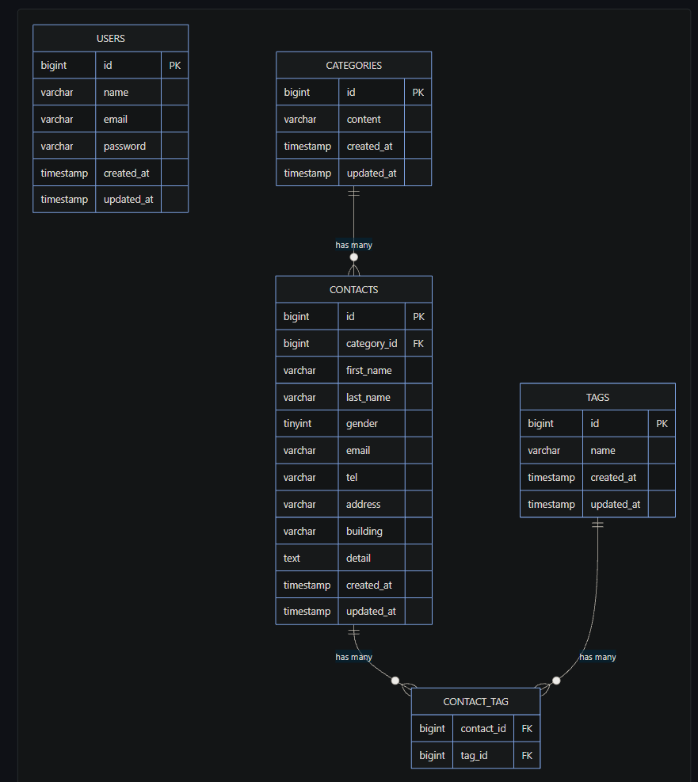

## プロジェクト名
COACHTECH お問い合わせフォーム

## 概要
お問い合わせの送信および管理を行うWebアプリケーションです。

一般ユーザーは、お問い合わせフォームから氏名、性別、メールアドレス、電話番号、住所、カテゴリー、お問い合わせ内容、タグなどを入力してお問い合わせを送信できます。

管理者は、管理画面からお問い合わせの検索・詳細確認・削除・CSV出力を行うことができます。また、タグの登録・編集・削除にも対応しています。

さらに、お問い合わせ情報の取得・登録・更新・削除を行うAPIを実装しています。

## ER図


## 環境構築手順
1. リポジトリのクローン

```bash
git clone https://github.com/kakeru1538/contact-form-app.git
cd contact-form-app
```

2. Composer依存パッケージのインストール

```bash
docker run --rm \
    -u "$(id -u):$(id -g)" \
    -v "$(pwd):/var/www/html" \
    -w /var/www/html \
    -e COMPOSER_CACHE_DIR=/tmp/composer_cache \
    laravelsail/php82-composer:latest \
    composer install
```

3. .envファイルの作成・設定

```bash
cp .env.example .env
```

`.env` のデータベース接続情報を以下のように設定します。

```env
DB_CONNECTION=mysql
DB_HOST=mysql
DB_PORT=3306
DB_DATABASE=laravel
DB_USERNAME=sail
DB_PASSWORD=password
```

※ `DB_HOST` は `localhost` や `127.0.0.1` ではなく、Dockerコンテナ名である `mysql` を指定します。

4. Sailの起動

```bash
./vendor/bin/sail up -d
```

必要に応じて、`sail` コマンドを使用できるようにエイリアスを設定します。

```bash
echo "alias sail='[ -f sail ] && bash sail || bash vendor/bin/sail'" >> ~/.zshrc
exec $SHELL
```

bashの場合：

```bash
echo "alias sail='[ -f sail ] && bash sail || bash vendor/bin/sail'" >> ~/.bashrc
exec $SHELL
```

5. アプリケーションキーの生成

```bash
sail artisan key:generate
```

6. データベースのマイグレーションと初期データ投入

```bash
sail artisan migrate --seed
```

既存のデータベースをリセットする場合：

```bash
sail artisan migrate:fresh --seed
```

7. フロントエンドのセットアップ

NPM依存パッケージをインストールします。

```bash
sail npm install
```

Vite開発サーバーを起動します。

```bash
sail npm run dev
```

`sail npm run dev` は実行したままにしておきます。


## 使用技術
- PHP 8.2
- Laravel 10.x
- MySQL 8.0
- Nginx
- Laravel Sail
- Docker
- Vite
- Tailwind CSS 3.4

## APIエンドポイント
| メソッド | エンドポイント | 機能 |
| --- | --- | --- |
| GET | `/api/v1/contacts` | お問い合わせ一覧取得・検索・ページネーション |
| GET | `/api/v1/contacts/{contact}` | お問い合わせ詳細取得 |
| POST | `/api/v1/contacts` | お問い合わせ新規登録 |
| PUT | `/api/v1/contacts/{contact}` | お問い合わせ更新 |
| DELETE | `/api/v1/contacts/{contact}` | お問い合わせ削除 |

## 開発環境URL
- お問い合わせフォーム：http://localhost/
- 管理画面：http://localhost/admin
- phpMyAdmin：http://localhost:8080/

## 作成者
林　翔琉